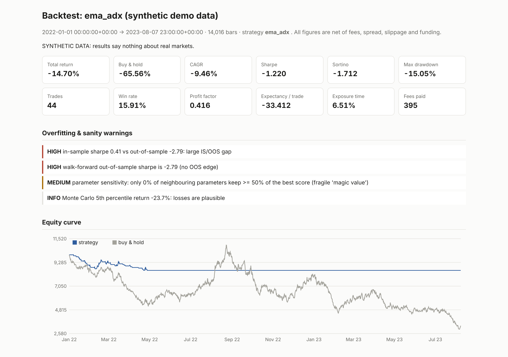
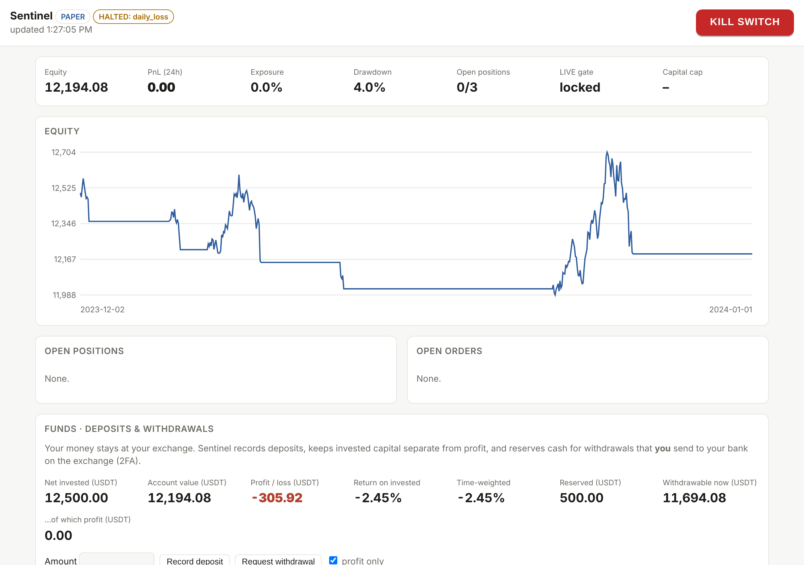

# Sentinel

[](https://github.com/MuhammadHaiderAbbas/TradingSystem/actions/workflows/ci.yml) · **Website & live demo:** https://muhammadhaiderabbas.github.io/TradingSystem/

A private, self-hosted, **paper-first** algorithmic trading system for crypto (ccxt: Binance,
Kraken, Coinbase) with a stock adapter (Alpaca) behind the same interface. Everything runs on
your own machine: no telemetry, no third-party signal services, no cloud dependencies.

> **Sentinel does not promise profit.** Every number it reports comes from a reproducible
> backtest or a paper/live log with fees and slippage included. On the bundled synthetic
> dataset the baseline strategies **lose money after costs**, which is the honest result (see
> [docs/PERFORMANCE.md](docs/PERFORMANCE.md)). Read the [risk disclosure](docs/RISK_DISCLOSURE.md).



## Principles, and where they are enforced

| Principle | Enforcement |
|---|---|
| Honesty over hype | Costs can't be zero (config validation); next-bar fills; buy & hold benchmark in every report; overfitting warnings; holdout reuse detection |
| Safety first | Independent risk manager signs every order (HMAC approval verified by the broker base class); default mode PAPER; LIVE locked behind the readiness gate and a capital cap |
| Privacy | No telemetry (config can't enable it); secrets in an argon2id + Fernet vault; local-only LLM endpoint |
| Correctness | Automated lookahead tests for every feature and strategy; purged/embargoed CV; walk-forward; untouched holdout |
| Clean engineering | Python 3.11+, typed, pydantic config, JSON logs, 210+ tests, Docker, per-module READMEs |

## Architecture

```
               ┌──────────────┐   closed bars   ┌──────────────────┐  target exposure
 exchange ───► │ data feed    │ ──────────────► │ strategies       │ ───────────────┐
 (ccxt / ws)   │ quality/repair│                │ + regime filter  │                │
               └──────────────┘                 │ + combiner (+ML) │                ▼
                     │ history                  └──────────────────┘        ┌──────────────┐
                     ▼                                                       │ Trader       │
               ┌──────────────┐                                              │ (same code in│
               │ SQLite store │◄──── equity, trades, orders, events ───┐     │ backtest/    │
               └──────────────┘                                      │     │ paper/live)  │
                     ▲                                                │     └──────┬───────┘
     reads ┌─────────┴────────┐                                       │            │ intent
           │ dashboard / CLI  │── kill switch / toggles ──► runner    │            ▼
           └──────────────────┘                                       │     ┌──────────────┐
                                                                      │     │ RiskManager  │ veto ─► logged
                                                                      │     │ sizing, caps,│
                                                                      │     │ halts, kill  │
                                                                      │     └──────┬───────┘
                                                                      │            │ signed approval
                                                                      │            ▼
                                                                      │     ┌──────────────┐
                                                                      └──── │ OrderManager │ idempotent ids,
                                                                            │ + reconcile  │ retries, recovery
                                                                            └──────┬───────┘
                                                                                   │ place_order(order, approval)
                                                                                   ▼
                                                     Broker (verifies approval) ─► SimBroker | PaperBroker | ccxt | Alpaca
```

```
sentinel/
  config/            example YAML config (no secrets)
  sentinel/
    core/            types, modes, state store, Trader, Runner
    data/            downloader, live feeds, quality checks, storage, resampling, synthetic data
    features/        indicators, feature registry, lookahead detector
    strategies/      base class, built-ins, plugins/, combiner + regime filter
    ml/              triple-barrier labels, purged CV, meta-label model, registry, sentiment
    risk/            risk manager, position sizing
    execution/       broker interface, sim/paper/ccxt/alpaca, order manager, reconcile, smart exec
    backtest/        engine, metrics, robustness suite, HTML report
    portfolio/       positions & PnL accounting
    monitoring/      JSON logging + redaction, alerts, health
    security/        vault, API-key safety checker
    gate/            LIVE readiness gate + capital cap
    funds/           deposits, withdrawals, profit accounting (money stays at the venue)
    dashboard/       FastAPI app + single-page UI
    ops/             backups, NTP check, performance reports
  tests/  scripts/  docker/  docs/  notebooks/
```

## Quick start (no API keys, no network: demo mode)

```bash
python3 -m venv .venv && . .venv/bin/activate
pip install -e ".[all,dev]"
cp config/sentinel.example.yaml config/sentinel.yaml
sentinel init                      # creates var/, the encrypted vault (asks for a master password)
sentinel demo                      # backtest + report, ML check, paper replay, readiness gate
make test                          # full test suite
```

`sentinel demo` uses a seeded **synthetic** dataset (`SYNTH-BTC/USDT`, `SYNTH-ETH/USDT`). Its
results say nothing about real markets.

## Real data, step by step

```bash
sentinel data download --timeframe 1h --timeframe 4h      # public endpoints, resumable
sentinel data report                                       # coverage, gaps, last update
sentinel backtest --strategy ema_adx --walk-forward --sensitivity fast,slow
sentinel backtest --strategy ema_adx --holdout --save-expectations   # ONCE, at the very end
sentinel paper                                             # live public prices, simulated fills
sentinel dashboard --set-password && sentinel dashboard    # http://127.0.0.1:8765
```

Then, after **8+ weeks** of paper trading:

```bash
sentinel vault set binance.api_key          # trade-only key, IP-whitelisted, NO withdrawals
sentinel vault set binance.api_secret
sentinel keycheck                           # refuses keys with withdrawal permission
sentinel kill --test                        # drill the kill switch while paper trading
sentinel gate                               # every check must PASS
sentinel live --confirm "I understand that I can lose real money"
```

LIVE starts with a capital cap (default 250 in quote currency). Raise it in steps with
`sentinel cap raise <amount>`, which requires weeks of live results that match paper.

## Deposits, withdrawals & profit

Your money stays in **your own exchange account** (UK: GBP via Faster Payments on Kraken or Coinbase).
Sentinel **records** deposits (read-only sync or manual) and keeps invested capital separate from profit, so
risk limits measure trading only. It **reserves** cash when you request a withdrawal, so the bot stops trading
it. **You** send the money to your bank on the exchange, with 2FA. Sentinel never holds funds and never uses a key that can
withdraw.

```bash
sentinel funds deposit 1000            # PAPER: simulated; LIVE: detected automatically
sentinel funds status                  # invested vs profit, withdrawable now
sentinel funds withdraw 250 --profit-only
sentinel funds confirm <id>            # after you've sent it on the exchange
sentinel funds export --year 2026      # CSV for HMRC records (not tax advice)
```

Full guide: [docs/FUNDING_UK.md](docs/FUNDING_UK.md). UK config profile: `config/uk-kraken.example.yaml`.

## Command reference

| Command | Purpose |
|---|---|
| `sentinel init` | config, state dirs, encrypted vault |
| `sentinel backtest` | honest backtest + walk-forward, Monte Carlo, sensitivity, holdout, HTML report |
| `sentinel paper` / `sentinel live` | run the bot (LIVE is gate-locked) |
| `sentinel status` | mode, locks, equity, positions, health |
| `sentinel kill [--no-close] [--test]` | cancel all orders, optionally flatten, lock |
| `sentinel unlock` | manual re-enable after a halt/kill (cooldown enforced) |
| `sentinel gate` | LIVE readiness checks |
| `sentinel data download / report` | market data |
| `sentinel vault set / list / delete` | secrets |
| `sentinel keycheck [--attest]` | API key permission check |
| `sentinel ml train / status` | meta-label filter; deploys only if it beats the baseline OOS |
| `sentinel dashboard` | local web UI |
| `sentinel report --period daily/weekly` | HTML performance report |
| `sentinel recon list / resolve` | reconciliation errors |
| `sentinel cap show / raise` | LIVE capital cap |
| `sentinel ops timecheck / backup / restore` | operations |
| `sentinel strategies` | list strategies and parameters |
| `sentinel funds status / deposit / withdraw / confirm / cancel / history / sync / export` | deposits, withdrawals, profit |

## Dashboard



Password-protected, bound to `127.0.0.1`. It shows equity, positions and orders, the risk panel
(distance to every limit), backtest vs paper vs live drift, per-strategy stats with
enable/disable toggles, the trade journal (features and risk checks per trade), system health,
events, and the **KILL SWITCH** (type `KILL` to confirm).

## Documentation

* [Performance report](docs/PERFORMANCE.md) (generated by `scripts/generate_performance.py`)
* Strategies: [EMA/ADX](docs/strategies/ema_adx.md), [RSI/Bollinger](docs/strategies/rsi_bb.md),
  [Donchian](docs/strategies/donchian.md), [Vol-adjusted momentum](docs/strategies/vol_momentum.md),
  [Supertrend MTF (plugin)](docs/strategies/supertrend_mtf.md), [Buy & hold](docs/strategies/buy_hold.md)
* [Deposits, withdrawals & profit (UK)](docs/FUNDING_UK.md)
* [Deployment](docs/DEPLOYMENT.md), [Runbook](docs/RUNBOOK.md), [Risk disclosure](docs/RISK_DISCLOSURE.md)
* Every package under `sentinel/` has its own `README.md`.

## Known limitations

* Exchange connectivity (ccxt, Alpaca) is tested against fake clients only. Run on testnet before anything else.
* Spot only: shorts are modelled (with funding) but there is no margin/liquidation model. Leverage is capped at 1x.
* Protective stops on ccxt venues are placed after the entry fills (not natively bracketed); order-type support differs per exchange.
* Postgres/TimescaleDB is provided in docker-compose but the bot uses SQLite (fine for a single machine).
* Paper fills use the quote ± fixed slippage; no order-book depth simulation.
* Backtests precompute signals (proven equivalent by lookahead tests); paper/live recompute them every bar.
* The ML filter and sentiment module are off by default, and the sentiment score isn't wired into any strategy.
